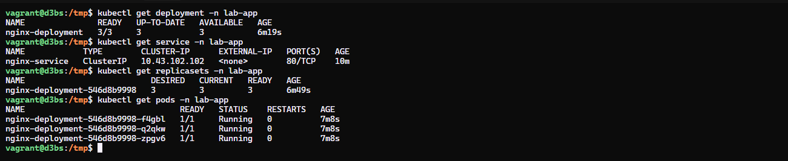

# Lab Vagrant + K3s

## Description

Ce lab déploie un petit cluster Kubernetes K3s sur deux machines virtuelles Debian 12 gérées par Vagrant et VirtualBox.

- `d3bs` est la VM server Kubernetes. Elle reçoit l'adresse privée `192.168.50.67` et héberge le control plane K3s.
- `d3bsw` est la VM worker. Elle reçoit l'adresse privée `192.168.50.69` et rejoint le cluster à l'aide du token partagé.
- Les deux VMs disposent chacune de 2 CPU et 2 Go de RAM.
- K3s et ses dépendances nécessaires sont installés automatiquement pendant le provisionnement.

Le fichier de configuration se trouve dans [`setup/Vagrantfile`](setup/Vagrantfile).

## Prérequis

Installer les outils suivants sur l'hôte :

- [Vagrant](https://www.vagrantup.com/downloads)
- [VirtualBox](https://www.virtualbox.org/wiki/Downloads)
- Une connexion Internet pour télécharger la box Debian et K3s

Le réseau privé `192.168.50.0/24` ne doit pas déjà être utilisé sur la machine hôte.

## Création du cluster

Depuis le dossier `setup`, démarrer les deux machines :

```bash
cd setup
vagrant up
```

Vagrant crée successivement `d3bs`, puis `d3bsw`. Le worker attend que le serveur accepte les connexions sur le port `6443` avant de l'intégrer au cluster.

Pour vérifier le statut des machines :

```bash
vagrant status
```

## Utiliser le cluster

Se connecter au serveur :

```bash
vagrant ssh d3bs
```

Puis vérifier que le serveur et le worker sont enregistrés :

```bash
kubectl get nodes
```

Résultat attendu :

```text
NAME   STATUS   ROLES                  AGE   VERSION
 d3bs    Ready    control-plane,master   ...   v...
 d3bsw   Ready    <none>                 ...   v...
```

Lister les pods du cluster :

```bash
kubectl get pods -A
```

## Déployer l'application de démonstration Nginx

### Introduction à Kubernetes

[`kubectl`](https://kubernetes.io/docs/reference/kubectl/) est le client en ligne de commande utilisé pour communiquer avec l'API Kubernetes. Il permet de créer, consulter, modifier et supprimer les ressources du cluster.

- **Namespace** : espace logique qui permet d'isoler et d'organiser les ressources Kubernetes. Le manifeste crée le namespace `lab-app`.
- **Deployment** : ressource qui décrit l'état souhaité de l'application, notamment son nombre de réplicas, son image de conteneur et ses ports. Le Deployment `nginx-deployment` crée trois Pods Nginx.
- **Service** : ressource réseau stable qui distribue le trafic entre les Pods correspondant à ses sélecteurs. Le Service `nginx-service` utilise l'adresse ClusterIP et redirige le port `80` vers le port `80` des Pods.

### Déployer avec kubectl

Les étapes suivantes utilisent le manifest [`deploy-demo/deployment.yaml`](deploy-demo/deployment.yaml), présent à la racine du projet partagé par Vagrant.

1. Depuis l'hôte, démarrer les machines et se connecter au serveur K3s :

   ```bash
   cd setup
   vagrant up
   vagrant ssh d3bs
   ```

2. Entrer dans le dossier partagé avec l'hôte. Le dossier du projet est accessible dans `/vagrant` depuis la VM :

   ```bash
   cd /vagrant/deploy-demo
   ls
   ```

3. Créer le namespace, le Deployment et le Service à partir du manifest YAML :

   ```bash
   kubectl apply -f deployment.yaml
   ```

   Kubernetes confirme normalement la création de trois ressources, par exemple :

   ```text
   namespace/lab-app created
   deployment.apps/nginx-deployment created
   service/nginx-service created
   ```

4. Vérifier le Deployment :

   ```bash
   kubectl get deployment -n lab-app
   ```

5. Vérifier le Service et récupérer son adresse ClusterIP :

   ```bash
   kubectl get service -n lab-app
   ```

6. Vérifier le ReplicaSet créé par le Deployment :

   ```bash
   kubectl get replicasets -n lab-app
   ```

7. Vérifier les trois Pods et leur état :

   ```bash
   kubectl get pods -n lab-app
   ```

8. Tester le Service depuis le serveur Kubernetes, en utilisant l'adresse ClusterIP affichée par la commande précédente :

   ```bash
   curl http://10.43.162.102
   ```

Pour suivre l'état des Pods pendant leur démarrage :

```bash
kubectl get pods -n lab-app -w
```

Pour afficher les détails d'une ressource et vérifier son sélecteur ou ses événements :

```bash
kubectl describe deployment nginx-deployment -n lab-app
kubectl describe service nginx-service -n lab-app
kubectl describe pods -n lab-app
```

### Résultat observé

La capture suivante montre les quatre commandes de vérification exécutées sur le serveur `d3bs` :



#### Explications

1. `vagrant@d3bs:/tmp$ kubectl get deployment -n lab-app`
   - `kubectl get deployment` demande la liste des Deployments.
   - `-n lab-app` limite la commande au namespace `lab-app`.
2. Ligne d'en-tête `NAME READY UP-TO-DATE AVAILABLE AGE` :
   - `NAME` contient le nom du Deployment, ici `nginx-deployment`.
   - `READY` vaut `3/3` : les 3 réplicas demandées sont prêtes.
   - `UP-TO-DATE` vaut `3` : les 3 réplicas utilisent la configuration actuelle du Deployment.
   - `AVAILABLE` vaut `3` : les 3 réplicas sont disponibles.
3. Ligne `nginx-deployment 3/3 3 3 6m19s` : il existe un seul Deployment nommé `nginx-deployment`, avec ses trois réplicas opérationnelles depuis environ 6 minutes et 19 secondes.
4. `vagrant@d3bs:/tmp$ kubectl get service -n lab-app`
   - Cette commande demande les Services du namespace `lab-app`.
5. Ligne `nginx-service ClusterIP 10.43.162.102 <none> 80/TCP 10m` :
   - `nginx-service` est le nom du Service.
   - `ClusterIP` signifie que l'accès est interne au cluster K3s.
   - `10.43.162.102` est l'adresse IP virtuelle distribuée par le Service.
   - `<none>` indique qu'aucune adresse externe n'est attribuée.
   - `80/TCP` montre que le Service écoute sur le port TCP 80.
   - `AGE` indique que le Service existe depuis environ 10 minutes.
6. `vagrant@d3bs:/tmp$ kubectl get replicasets -n lab-app`
   - Cette commande demande le ReplicaSet géré par le Deployment dans `lab-app`. Kubernetes crée un ReplicaSet pour maintenir le nombre de Pods demandé.
7. Ligne d'en-tête `NAME DESIRED CURRENT READY AGE` :
   - `DESIRED` indique le nombre de Pods demandé.
   - `CURRENT` indique le nombre de Pods actuellement créés.
   - `READY` indique le nombre de Pods prêts.
   - `AGE` indique depuis combien de temps le ReplicaSet existe.
8. Ligne `nginx-deployment-546d8b9998 3 3 3 6m49s` : ce ReplicaSet porte comme préfixe le nom du Deployment, est configuré pour gérer 3 Pods et les 3 Pods sont créés et prêts.
9. `vagrant@d3bs:/tmp$ kubectl get pods -n lab-app`
   - Cette commande demande les Pods du namespace `lab-app`.
10. Ligne d'en-tête `NAME READY STATUS RESTARTS AGE` :
    - `NAME` est l'identifiant unique du Pod.
    - `READY` indique le nombre de conteneurs prêts sur le nombre attendu.
    - `STATUS` indique l'état actuel du Pod.
    - `RESTARTS` indique combien de fois les conteneurs ont redémarré.
    - `AGE` indique depuis combien de temps le Pod existe.
11. Les trois lignes commençant par `nginx-deployment-546d8b9998-f4gb1`, `-g2qkw` et `-zpgv6` sont les trois Pods créés par le ReplicaSet.
12. Dans chaque ligne, `1/1` signifie que l'unique conteneur du Pod est prêt.
13. Dans chaque ligne, `Running` signifie que le conteneur Nginx est en cours d'exécution.
14. `0` indique qu'aucun des conteneurs Nginx n'a redémarré.
15. `7m8s` indique que les trois Pods ont été démarrés il y a environ sept minutes.
16. `vagrant@d3bs:/tmp$` sur la dernière ligne est le prompt affiché après l'exécution des commandes. Il indique que la VM est prête à recevoir une nouvelle commande.

### Supprimer l'application de démonstration

```bash
kubectl delete namespace lab-app
```

La suppression du namespace supprime aussi les resources qu'il contient, notamment le Deployment, le ReplicaSet, les Pods et le Service.

## Commandes utiles

Depuis le dossier `setup` :

```bash
# Se connecter au serveur
vagrant ssh d3bs

# Se connecter au worker
vagrant ssh d3bsw

# Arrêter les deux VMs
vagrant halt

# Redémarrer les VMs
vagrant up

# Rejouer le provisionnement
vagrant provision

# Supprimer entièrement les VMs
vagrant destroy -f
```

## Résolution de problèmes

Afficher les logs de provisionnement :

```bash
vagrant up --debug
```

Si le worker n'apparaît pas dans le cluster, vérifier depuis `d3bsw` que le port API du serveur est joignable, puis consulter le service K3s :

```bash
nc -zv 192.168.50.67 6443
sudo systemctl status k3s-agent
sudo journalctl -u k3s-agent -f
```

Sur le serveur, les logs du service peuvent être consultés avec :

```bash
sudo systemctl status k3s
sudo journalctl -u k3s -f
```
